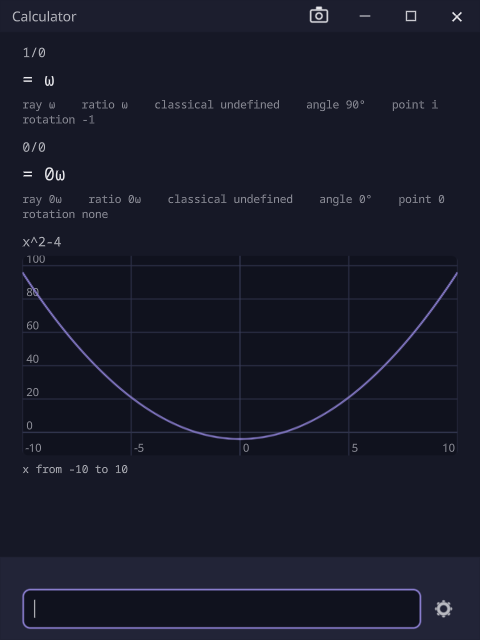

# Calculator

**An ordinary-looking calculator that divides by zero.**

`1/0` is `Q(1, 0)`, and `0/0` is `Q(0, 0)`: an answer, not an error. Under it is traction, the number model built
by [cott-engine](https://github.com/sibarum/cott-engine) and proven in [cott-lean](https://github.com/sibarum/cott-lean).
An answer is a pair that is never reduced, and the calculator implements only what the proofs cover.

## The tape

- **Type a line and press Enter.** The line, its answer and its readings go on the tape, newest last.
- **Every answer says first how much of it is exact**, then reads it other ways: the number it stands for, where
  there is one, and for a ratio of two whole numbers such as `Q(1, 0)` its `ray`, `ratio`, `angle` and
  `classical` reading (what an ordinary calculator says, which is `undefined`). An answer that is a double shows
  its exact value, its hex form and its bits. The
  [cott-engine README](https://github.com/sibarum/cott-engine#readings-and-rungs) says what each one is.
- **A line with one free variable is plotted**: `x^2-4` draws its curve, with `x` from −10 to 10. The curve goes
  through the calculator as it is set, so `cos`, `sin` and `e^x` plot too.
- **Definitions are kept**: after `x = 1`, later lines use it.
- **Numbers are exact by default.** With the Integer number type, decimals are refused, so write `1/2`. Type `\o`
  for `ω`.
- **Past lines come back to the entry**: Up and Down step through what you typed, and a click on a line adds it to
  the entry. Holding Ctrl numbers the nine newest lines, and Ctrl with a number puts that answer at the caret.

## Settings

The gear beside the entry opens them in a window of their own:

- **Number type**: Integer (exact, the default), Decimal, or IEEE 64-bit, where `1/0` is infinity as in any other
  calculator.
- **Size limit**: how large a number may be. An Integer over it is refused; a Decimal is rounded, and says so.
- **Form**: which way a sum and a product nest when they meet. Both forms hold the same value.
- **Recursion limits**: how far the steps behind `cos` and `sin` may go. Each limit is a count of steps, not a
  time, so a line gives the same answer on every machine; a line that needs more is refused, not cut short.

A change applies to the lines entered after it. Lines already on the tape keep their answers, and definitions
carry over.

## With the rest of the suite

Installing adds `calculator` to your PATH, so `calculator` in a [MainFrame](mainframe.md) tab opens one. It does not
open files, so the other applications have nothing to hand it.

## Status

Evaluation, readings, plots and the settings work. It is part of the 0.1.0 prerelease.

[Install the suite](../install/) · [Source](https://github.com/sibarum/calculator-vexel-demo)
