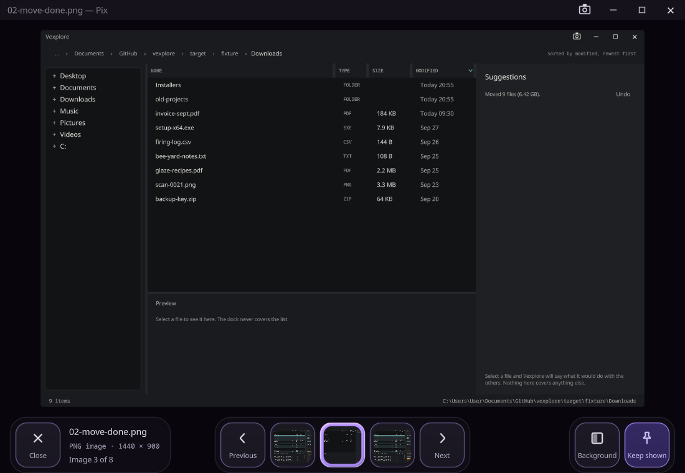

# Pix

**Pictures, animations and video: one at a time, as large as the window allows, and the rest of the folder a key
press away.**

Open a picture or a video and Pix shows it whole, with the folder it is in one key away. A picture is never
enlarged past its own pixels; a video fills the window, as players show it. The controls float over it and fade
when the pointer rests.

## Opening one

- **Ctrl+O**, or a click on the name, opens a picture or a video, and its folder comes with it.
- **Ctrl+Shift+O** opens a folder on its first one.
- Both use the system's own dialogs, starting in the folder that is open. Started with nothing, Pix shows the
  first image in your Pictures folder.

## Video

MP4, MKV, WebM, MOV, AVI, TS and the others FFmpeg reads are listed beside the pictures, with what each one is
under its name (*H.264 video · 1920 × 1080 · 0:42*), and play as soon as they are shown.

- **The transport** takes the filmstrip's place: play and pause, a frame back and on, a seek bar, the clock and the
  frame, loop, mute and the volume. **Space** plays and pauses, **,** and **.** step exactly one frame (with
  **Shift**, a second), **L** loops, **M** mutes.
- **The arrows are the video's** while one is shown: **← →** seek 5 seconds, **↑ ↓** turn it up and down.
  Page Up and Page Down still step through the folder.
- **The sound plays with it**, and the pictures keep time by what is being heard, so they never drift from it.
  The volume and the mute are kept from one video to the next, and between runs.
- **The seek bar shows the frame under the pointer**, with its time, before you click. Those frames come from a
  second, small decode of the file, so looking never disturbs what is playing.
- A video pauses where it is while Pix is not the window in front, and plays on when it is again.
- **An animated GIF, WebP or APNG plays the same way**, with the same transport and keys, however long or large.

## Built to play smoothly

Decoding happens off the frame loop. Frames are decoded a few ahead of the one on screen, scaled to at most
2560 px, given their mipmaps and streamed straight to the GPU, so each is ready before it is due. The frames
already shown are kept, up to a budget (256 MB for a video), so stepping or seeking back over them is instant; a
seek further off is FFmpeg's exact seek, landing on the frame asked for. The folder gets the same care: holding an
arrow key decodes only where it stops, the next files are read ahead, and recent ones kept.

## Looking closely

- **The wheel zooms** about the pointer, and a drag moves the picture or the video. Pulled past the edge it gives
  and springs back.
- **R** and **Shift+R** turn it a quarter, **Ctrl+drag** turns it to any angle, **H** and **V** mirror it.
  **0** fits it again. Nothing is ever written to the file.
- **A precision touchpad, on Windows, is read finger by finger**: two fingers pan, pinch and twist together,
  quarter turns and the fitted size pull like magnets, a three-finger swipe goes to the next or previous file, and
  a two-finger double tap goes to the picture's own pixels and back.
- **Sharp at rest**: a moment after it stops moving, what is on screen is made again from the file's own pixels,
  at exactly the size shown, in linear light. Settings chooses the scaling filter, moving and at rest, from eight.
- **Full screen** with a double click or **F11**; **Esc** or **F11** comes back.

## Stepping through a folder

- **← and →** (Page Up and Page Down on a video), and **Home** and **End**, step to the previous, next, first and
  last file. The new one slides in from the side it came from.
- **The filmstrip** shows the neighbours, a video by a still from a little way in; a click shows one.
- Files are in name order, with numbers compared as numbers, so `IMG_9` comes before `IMG_10`.

## Formats

Pictures: PNG, JPEG, GIF, WebP, AVIF, BMP, TIFF, SVG, ICO and the rest, animated where the file is. Video: whatever
FFmpeg decodes, H.264, HEVC, VP9 and AV1 among them, in MP4, MKV, WebM, MOV, AVI and the other common containers. A
file that will not open says why in place of the picture. Nothing in a file is ever run.

## The view

- **Background**: Auto, dark, light, a checkerboard, magenta or green. **Auto** is the picture's own: the
  checkerboard behind transparency, and otherwise a dimmed colour drawn from its edges, as if it lit the room.
- **Keep shown** stops the controls fading. Moving the mouse, a click or Tab brings them back.
- **Every key and gesture can be changed** in the key bindings, from the keyboard in the title bar.

## With the rest of the suite

Open a picture or a video in [Vexplore](vexplore.md) and it goes to Pix. Without Pix, Vexplore shows it in a viewer
of its own, which is the same viewer. `pix <file>` opens a file and `pix <folder>` the first one in a folder.

## Status

Pictures, animations and video, with sound, work on Windows and Linux. FFmpeg's libraries are installed beside Pix
as separate files; without them Pix still shows pictures, and a video says its decoder is unavailable.

[Install the suite](../install/) · [Source](https://github.com/sibarum/Pix)
